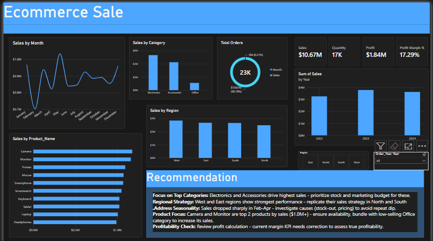

# ecommerce-sales-analysis
End-to-end E-Commerce analysis of $11M sales &amp; 17K orders. Cleaned raw data with Excel Power Query &amp; MySQL (NULLs, TRIM, Data Types, Duplicates), analyzed with SQL GROUP BY/HAVING, built interactive Power BI dashboard with DAX, KPIs &amp; business recommendations.
# E-Commerce Sales Analysis | $11M Sales, 17K Orders

**Tools:** Excel Power Query, MySQL Workbench, Power BI, DAX

### Project Workflow
1.  **Raw Data:** Explored 11-column e-commerce dataset
2.  **Cleaning:** Used Power Query (TRIM, Remove NULLs, Data Types, Remove Duplicates) + MySQL (IS NULL, GROUP BY, HAVING)
3.  **KPIs:** Total Sales $11M, Profit $2M, Profit Margin 17.29%, Orders 23K
4.  **Dashboard:** Built in Power BI with slicers for Region & Year
5.  **Insight:** Electronics = top category, West = top region, Feb-Apr dip needs review.

### Files in this repo
- `ecommerce_sales_raw_data.csv` - Original
- `ecommerce_Clean_Data.csv` - After Power Query
- `data_cleaning.sql` - SQL cleaning & analysis
- `Ecommerce Sales.pbix` - Interactive dashboard
- `Dashboard.png` - Final view
